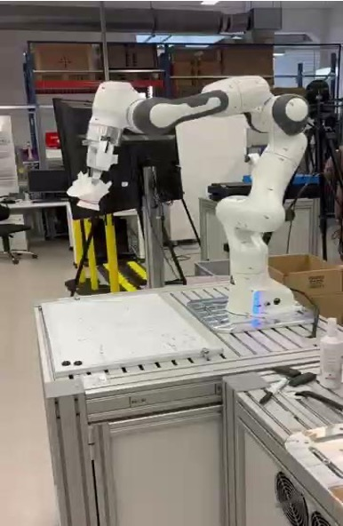

# assignment-erasing

## Overview
This assignment challenges you to relaibly polish a whiteboard clean using the Franka Robotics FR3 robot arm. 

For this assignment you will be provided a PC that is preconfigured with Ubuntu 22 running a realtime kernel with libfranka installed. 

We invite you to use the [*pylibfranka*](https://github.com/frankarobotics/libfranka/tree/main/pylibfranka) library and try to re-use as much code as possible from the previous assignment with the Universeal Robot. 

Franka FR3/Panda is not well supported on RoboDK at this time (please inform us otherwise!).

## Assignment
As a robot developer, create a program for a *novice user* to draw and erase a drawing on a flat pre-determined area of a dry-erase whiteboard Franka FR3 robot. Your program should run smoothly and be easy to use. Remember to keep motions clean of extra movements and cycle time should be kept to a minimum. 

## Grading Criteria:
- Project is documented with a README file with instructions on how to start program.
- Program runs without errors.
- Robot erases a user-defined area on a flat surface within the workspace of the robot.

## Submission Requirements

- Individual contribution plan as a table for each member of the group, 
- Video of your robot drawing and then erasing the word “IMPL” from a whiteboard (.mp4),
- Source files for your program,
- README.md file with all team member names describing your strategy and implementation

## Instructions:
- Work in groups
- Only **one group on the robot at a time**
- Use the simulator on your PC when the robot is unavailable
- Submit via GitLab as a **pull request** to this repository
- Organize your submission in a folder: " student_work_group_XYZ"
- Document your work in your README

## Deadline

- **Part 1:** Submit the individual contribution table as a README_group.md by **November 23, 2026** end of day.

- **Part 2:**
  By Due Date: **Wednesday, December 2nd, 2026** end of day:
  1. Submit via Pull Request to this repo by 
  AND
  2. Submit your [Peer Assessment Form](https://docs.google.com/forms/d/e/1FAIpQLSc3YdC3TNQ5UfS_ohdPhIrgeUPIk3PaCPNzE0P_F88b8PIcCA/viewform?usp=dialog)

## Resources
- Robotics: Modeling, Planning, and Control (Siciliano B. et al; 2009) https://link.springer.com/book/10.1007/978-1-84628-642-1 
- Franka Robotics website: https://franka.de/develop 
- Intro to Franka Control Interface video: https://www.youtube.com/watch?v=91wFDNHVXI4
- ROS2 Humble Dockerhub image: https://hub.docker.com/_/ros/ 